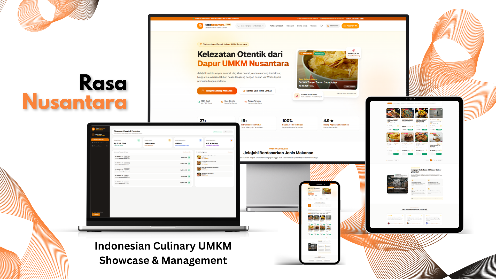

# Rasa Nusantara - Indonesian Culinary UMKM Showcase & Management

[](https://nextjs.org/)
[](https://react.dev/)
[](https://www.typescriptlang.org/)
[](https://tailwindcss.com/)
[](https://expressjs.com/)
[](https://nodejs.org/)
[](https://www.prisma.io/)
[](https://www.mysql.com/)
[](https://www.docker.com/)
[](./LICENSE)

<p align="center">
  
</p>

Rasa Nusantara is a full-stack digital showcase, multi-item ordering, and vendor operations management platform engineered specifically for Indonesian culinary Micro, Small, and Medium Enterprises (MSMEs / *UMKM*). Across the Indonesian archipelago, traditional food artisans produce hundreds of authentic regional delicacies—from Manado's spicy Sambal Roa and Bukittinggi's slow-cooked Rendang Suwir to Malang's artisanal Tempeh Chips and Garut's traditional Dodol. However, these grassroots producers frequently face digital distribution hurdles, relying on manual chat threads, uncoordinated ordering processes, and fragmented customer communications.

The platform bridges this gap by delivering a unified, dual-purpose ecosystem: a modern, public-facing digital storefront (*Customer Showcase*) paired with a secure, role-based administrative portal (*Admin & Vendor Portal*). Built using Next.js 16 (App Router) and React 19 on the frontend with an Express.js, TypeScript, and Prisma ORM backend powered by MySQL 8.0, the architecture operates strictly on real-time persistent relational data with zero client-side dummy mockups.

For consumers, Rasa Nusantara offers frictionless culinary discovery across 16+ Indonesian cities, featuring rich culinary provenance stories, certified health and halal credentials (P-IRT and Halal Indonesia), real-time inventory counters, a persistent multi-item cart drawer with automatic package weight calculations for courier logistics, and direct two-way WhatsApp order placement. For registered vendors and system administrators, the platform delivers role-based catalog governance, real-time order lifecycle tracking with logistics courier dispatching (JNE, Paxel, SiCepat), super-admin partner onboarding queues, and centralized store profile management.

---

## Features

### 1. Customer Showcase & Culinary Discovery
- **Authentic Archipelago Catalog**: Browse 37+ verified regional delicacies across 16+ Indonesian cities, featuring high-resolution photography, shelf-life indicators, net weight specifications, and official legal certification badges (P-IRT and Halal Indonesia).
- **Dynamic Category Navigation**: Instant filtering across 6 culinary classifications (*Keripik & Cemilan*, *Sambal & Bumbu*, *Lauk & Makanan Khas*, *Kue & Pastry*, *Frozen Food*, *Minuman Tradisional*) with live product counters sourced directly from MySQL.
- **Multi-Filter & Interactive Sorting**: Real-time client-side search across food names, producer cities, and regional spice ingredients, combined with quick filters (*All*, *Best Seller*, *Promotions / Discounts*) and dynamic sorting (*Most Popular*, *Price: Low to High*, *Price: High to Low*, *Highest Rated*, *Newest*).
- **Responsive Pagination Engine**: Switch between 8, 12, 16, or 24 items per page with numeric page routing, previous/next controls, and smooth auto-scrolling to the catalog header on page change.
- **Rich Product Detail Modal**: Comprehensive culinary profile presenting full spice compositions, producer artisan profiles, storage recommendations, packaging specifications, and quick WhatsApp ordering.
- **Client-Side Wishlist Drawer**: Save favorite dishes locally for quick revisit without mandatory user account creation.
- **MSME Storytelling Showcase**: Dedicated artisan narrative section highlighting the historical heritage, regional origins, and master cooks behind authentic Indonesian recipes.

### 2. Multi-Item Cart & WhatsApp Checkout Engine
- **Persistent Cart Drawer**: Manage order quantities, custom preparation notes (spiciness levels and packaging preferences), and live subtotal calculations.
- **Automated Logistic Weight Calculation**: Automatically calculates cumulative cart weight in grams and kilograms to streamline courier shipping rate estimations.
- **Dual-Path Ordering System**:
  - *Quick Order*: Single-click direct WhatsApp inquiry to the individual vendor for single items.
  - *Multi-Vendor Consolidated Cart*: Multi-item shopping bag supporting consolidated checkout across different producers, capturing recipient full name, WhatsApp contact, delivery address, and notes.
- **Synchronized Order Creation**: Automatically persists order records into the backend MySQL database with unique generated receipts formatted as `RN-YYYYMMDD-XXX` before dispatching the pre-formatted order message to WhatsApp.

### 3. Role-Based Management Portal (`/admin`)
- **Granular Role-Based Access Control (RBAC)**: Interface guards and JWT-authenticated API endpoints supporting two distinct operational tiers:
  - **Super Admin**: Nationwide oversight across all producers, complete catalog governance, all customer orders, partner verification queue, and master store settings.
  - **MSME Partner (*Mitra UMKM*)**: Scoped access restricted strictly to their own brand's inventory, menu items, and incoming order fulfillment.
- **Business KPI Metrics**: Executive dashboard cards tracking estimated sales volume, total order count, active products, and registered vendor partners.
- **Full Inventory CRUD**: Add, edit, and archive food products with category badges, pricing, discount tiers, image URLs, stock status (*Ready Stock* vs. *Pre-Order*), and certification IDs.
- **Order Lifecycle & Dispatch Management**: Audit orders across lifecycle states (*Pending*, *Processing*, *Shipped*, *Completed*, *Cancelled*), assign logistics couriers (JNE, Paxel, SiCepat), input tracking airway bills (resi), and notify customers via one-click WhatsApp message templates.
- **MSME Partner Onboarding Verification (Super Admin)**: Central review queue for prospective culinary producers submitting partnership applications from the landing page, featuring one-click Approval, Rejection, and direct WhatsApp interview links.
- **Central Store Configuration (Super Admin)**: Update central store identity, coordinator WhatsApp hotline, cooperative banking details for manual bank transfers, warehouse address, and public promotional announcement banners.

### 4. Production-Ready Security & Architecture
- **Layered Defense-in-Depth**: Hardened with Helmet HTTP response headers (CSP, frameguard, XSS filter, HSTS), rate limiters for general API traffic and authentication attempts, and strict CORS policies.
- **Bcrypt Password Security**: Passwords hashed with salted Bcrypt (10 rounds) prior to database insertion; raw passwords are never logged or stored.
- **Zod Data Validation**: Robust schema validation for incoming request bodies and query parameters, guaranteeing type safety before controller execution.
- **Prisma Prepared Statements**: Fully parameterized relational queries preventing SQL injection across all database read and write operations.
- **Zero Dummy Data Guarantee**: Next.js App Router fetches live relational datasets directly from the backend API via reverse proxy routing (`/api/*`).

---

## Preview & Demo

### Customer Storefront & Culinary Catalog Experience


*The public customer-facing interface: Hero presentation with regional culinary telemetry (top-left); dynamic category selector with live stock badges (top-center); multi-parameter catalog search, quick filter pills, and sorting controls (top-right); rich product detail modal presenting Halal & P-IRT badges, storage instructions, and spice compositions (bottom-left); multi-item shopping cart drawer calculating total gross weight in kilograms with delivery address form (bottom-center); and the MSME partner onboarding registration modal (bottom-right).*

### Admin Command Center & MSME Vendor Management Portal


*The administrative and vendor operational command center: High-level KPI telemetry tracking total gross revenue, active order volume, published products, and partner counts (top-left); inventory CRUD table with regional origin chips, pricing tiers, and stock availability toggles (top-right); order fulfillment pipeline featuring status updates, courier carrier assignment, tracking airway bill inputs, and direct WhatsApp customer update triggers (bottom-left); and the Super Admin MSME partner application queue with Approve and Reject action buttons (bottom-right).*

---

## Tech Stack

### Core Technologies

- **Frontend Framework**: [Next.js 16.4 (App Router)](https://nextjs.org/)
- **UI Library**: [React 19.3](https://react.dev/) & [React DOM 19.3](https://react.dev/)
- **Styling & Design System**: [Tailwind CSS 4.x](https://tailwindcss.com/) with `@tailwindcss/turbopack`
- **Iconography**: [Lucide React 1.56](https://lucide.dev/)
- **Backend API Runtime**: [Node.js 20.x](https://nodejs.org/) with [Express.js 4.21](https://expressjs.com/)
- **Programming Language**: [TypeScript 5.x](https://www.typescriptlang.org/) (Strict mode across frontend and backend)
- **Database & ORM**: [MySQL 8.0](https://www.mysql.com/) via [Prisma ORM 5.22](https://www.prisma.io/)
- **Containerization**: [Docker](https://www.docker.com/) & [Docker Compose](https://docs.docker.com/compose/)

### Libraries & Backend Infrastructure

- **Schema Validation**: [Zod 3.24](https://zod.dev/)
- **Authentication**: [JSON Web Token (jsonwebtoken 9.0)](https://github.com/auth0/node-jsonwebtoken) & [bcryptjs 2.4](https://github.com/dcodeIO/bcrypt.js)
- **Security Middlewares**: [Helmet 8.0](https://helmetjs.github.io/), [express-rate-limit 7.5](https://github.com/express-rate-limit/express-rate-limit), [CORS 2.8](https://github.com/expressjs/cors)
- **HTTP Logging**: [Morgan 1.10](https://github.com/expressjs/morgan)
- **Development Tooling**: [tsx 4.19](https://tsx.is/), [ESLint 9](https://eslint.org/), [dotenv 16.4](https://github.com/motdotla/dotenv)

---

## Prerequisites

Ensure the following runtimes and tools are installed on your workstation prior to local setup:

| Prerequisite | Minimum Version | Required For |
| :--- | :--- | :--- |
| **Node.js** | `v20.x LTS` (v20.17+ recommended) | Local development runtime (Frontend & Backend) |
| **npm** | `v10.x` | Package management and script execution |
| **Docker Engine & Compose** | `Docker v24+` / `Compose v2.20+` | Containerized full-stack deployment (Recommended) |
| **MySQL Server** | `v8.0+` (or Laragon / XAMPP) | Local database service (if running without Docker) |

---

## Installation & Setup

### 1. Clone the Repository

```bash
git clone https://github.com/weztcy/Rasa-Nusantara---Indonesian-Culinary-UMKM-Showcase-Management.git
cd "Rasa-Nusantara---Indonesian-Culinary-UMKM-Showcase-Management"
```

---

### Option A: Running with Docker Compose (Recommended)

Docker Compose automates the entire orchestration: configuring the isolated bridge network, spinning up the MySQL 8.0 database, running Prisma migrations and seeders, compiling the Express API service, and launching the Next.js standalone container.

1. **Configure Environment Variables**:
   ```bash
   cp .env.example .env
   ```

2. **Launch Containers**:
   ```bash
   docker compose up --build
   ```

3. **Verify Service Health**:
   - Frontend application: [http://localhost:3000](http://localhost:3000)
   - Backend REST API: [http://localhost:5000](http://localhost:5000)
   - Healthcheck endpoint: [http://localhost:5000/health](http://localhost:5000/health)

---

### Option B: Manual Local Setup (Bare Metal)

If you prefer running services directly on your host machine using a local MySQL instance (such as Laragon or MySQL Community Server):

#### 1. Database Preparation
Create a dedicated MySQL database:
```sql
CREATE DATABASE rasanusantara_db CHARACTER SET utf8mb4 COLLATE utf8mb4_unicode_ci;
```

#### 2. Backend Setup
Navigate into the `backend/` directory, install dependencies, sync the database schema, and seed initial records:

```bash
cd backend

# Copy environment template
cp .env.example .env

# Install backend dependencies
npm install

# Push database schema to MySQL
npx prisma db push

# Seed database with initial products, categories, partners, and credentials
npm run prisma:seed

# Start backend development server
npm run dev
```

The backend API server will listen at `http://localhost:5000`.

#### 3. Frontend Setup
In a new terminal window, navigate into the `frontend/` directory, install dependencies, and start the Next.js development server:

```bash
cd frontend

# Install frontend dependencies
npm install

# Start Next.js with Turbopack development server
npm run dev
```

The customer storefront and admin dashboard will be accessible at `http://localhost:3000`.

---

## Environment Variables

### Root Orchestration (`.env.example`)

Used by Docker Compose to orchestrate MySQL, backend, and frontend containers:

| Variable | Description | Safe Default / Example | Required |
| :--- | :--- | :--- | :---: |
| `DB_ROOT_PASSWORD` | MySQL root administrative password | `rootpassword` | Yes |
| `DB_NAME` | MySQL database name | `rasanusantara_db` | Yes |
| `DB_USER` | MySQL application username | `umkm_user` | Yes |
| `DB_PASSWORD` | MySQL application password | `umkm_password` | Yes |
| `DB_PORT` | Host exposed port for MySQL service | `3306` | Yes |
| `PORT` | Express API internal & host port | `5000` | Yes |
| `NODE_ENV` | Application runtime environment | `production` | Yes |
| `JWT_SECRET` | Secret key used to sign and verify JWT tokens | *(secure string)* | Yes |
| `JWT_EXPIRES_IN` | JWT token validity lifespan | `7d` | Yes |
| `CORS_ORIGIN` | Allowed client origin for CORS requests | `http://localhost:3000` | Yes |
| `RATE_LIMIT_WINDOW_MS` | Rate limiting sliding window duration in ms | `900000` (15 min) | No |
| `RATE_LIMIT_MAX_REQUESTS` | Maximum requests per IP per window | `1000` | No |
| `FRONTEND_PORT` | Host exposed port for Next.js application | `3000` | Yes |
| `INTERNAL_API_URL` | Docker network internal URL for server-side proxy | `http://backend:5000` | Yes |
| `NEXT_PUBLIC_API_URL` | Client-side API root path | `/api` | Yes |

### Backend Service (`backend/.env.example`)

| Variable | Description | Safe Default / Example | Required |
| :--- | :--- | :--- | :---: |
| `PORT` | Local port for Express API | `5000` | Yes |
| `NODE_ENV` | Environment mode (`development` or `production`) | `development` | Yes |
| `DATABASE_URL` | Prisma MySQL connection string | `mysql://root:@127.0.0.1:3306/rasanusantara_db` | Yes |
| `JWT_SECRET` | Secret key for signing authentication tokens | `your_super_secret_jwt_key_here` | Yes |
| `JWT_EXPIRES_IN` | Token expiration duration | `7d` | Yes |
| `CORS_ORIGIN` | Origin allowed to make cross-origin requests | `http://localhost:3000` | Yes |
| `RATE_LIMIT_WINDOW_MS` | Rate limiter window in milliseconds | `900000` | No |
| `RATE_LIMIT_MAX_REQUESTS` | Allowed requests per window | `1000` | No |

### Frontend Service (`frontend/.env.local`)

| Variable | Description | Safe Default / Example | Required |
| :--- | :--- | :--- | :---: |
| `INTERNAL_API_URL` | Upstream backend API URL for Next.js rewrites | `http://localhost:5000` | Yes |
| `NEXT_PUBLIC_API_URL` | Base API route prefix consumed by client components | `/api` | Yes |

---

## Usage / Running the Project

### Accessing Interfaces

- **Customer Showcase & Storefront**: [http://localhost:3000](http://localhost:3000)
- **Product Details**: [http://localhost:3000/produk/[id]](http://localhost:3000)
- **Vendor & Admin Login**: [http://localhost:3000/login](http://localhost:3000/login)
- **Management Dashboard**: [http://localhost:3000/admin](http://localhost:3000/admin)
- **Backend API Root**: [http://localhost:5000](http://localhost:5000)
- **Backend Health Check**: [http://localhost:5000/health](http://localhost:5000/health)

### Default Seeded User Credentials

The database seeder (`prisma/seed.ts`) populates 4 predefined test accounts with distinct roles and brand ownership:

| Persona / Role | Brand / Producer Entity | City | Email | Password | Access Privileges |
| :--- | :--- | :--- | :--- | :--- | :--- |
| **Super Admin** | Pusat Rasa Nusantara | Jakarta | `admin@rasanusantara.id` | `admin123` | **Unrestricted Access**: Full catalog CRUD, order tracking, partner application verification (Approve/Reject), store configurations |
| **Mitra UMKM** | Dapur Bu Harti | Malang | `buharti@malang.id` | `mitra123` | **Scoped Vendor Access**: Manage products and fulfillment exclusively for Dapur Bu Harti |
| **Mitra UMKM** | Rendang Uni Nel | Bukittinggi | `uninel@bukittinggi.id` | `mitra123` | **Scoped Vendor Access**: Manage products and fulfillment exclusively for Rendang Uni Nel |
| **Mitra UMKM** | Pempek Cek Mey | Palembang | `cekmey@palembang.id` | `mitra123` | **Scoped Vendor Access**: Manage products and fulfillment exclusively for Pempek Cek Mey |

---

## Available Scripts / Commands

### Backend (`backend/package.json`)

| Command | Description |
| :--- | :--- |
| `npm run dev` | Starts Express API in development mode with `tsx watch` for hot-reloading |
| `npm run build` | Compiles TypeScript source code to production JavaScript in `dist/` |
| `npm start` | Runs the compiled production server (`node dist/server.js`) |
| `npm run prisma:generate` | Generates the strongly typed Prisma Client library from schema |
| `npm run prisma:migrate` | Runs Prisma schema migration wizard in development mode |
| `npm run prisma:push` | Synchronizes the Prisma schema definition directly into MySQL without migration files |
| `npm run prisma:seed` | Populates database with 37+ authentic culinary products, 16 producers, orders, and users |
| `npm run prisma:studio` | Launches visual Prisma Studio GUI at `http://localhost:5555` to inspect tables |

### Frontend (`frontend/package.json`)

| Command | Description |
| :--- | :--- |
| `npm run dev` | Launches Next.js 16 development server with Turbopack on port `3000` |
| `npm run build` | Compiles and optimizes Next.js production bundle with standalone server output |
| `npm start` | Runs the production-optimized Next.js standalone server |
| `npm run lint` | Runs ESLint 9 checks to validate code quality and syntax integrity |

---

## API Reference / Documentation

All endpoints are hosted under `/api` and return standardized JSON payloads:

### 1. Service Health & Status
- **`GET /health`**
  - **Access**: Public
  - **Response**: `200 OK`
  ```json
  {
    "status": "UP",
    "timestamp": "2026-10-30T01:30:00.000Z",
    "uptime": 128.45
  }
  ```

### 2. Authentication (`/api/auth`)
- **`POST /api/auth/login`**
  - **Access**: Public
  - **Body**:
    ```json
    {
      "email": "admin@rasanusantara.id",
      "password": "admin123"
    }
    ```
  - **Response**: `200 OK` with Bearer JWT token and sanitized user profile.
- **`GET /api/auth/me`**
  - **Access**: Authenticated (`Authorization: Bearer <token>`)
  - **Response**: `200 OK` with active user identity and associated producer profile.

### 3. Categories (`/api/categories`)
- **`GET /api/categories`**
  - **Access**: Public
  - **Response**: `200 OK` returning an array of culinary categories with live product count aggregations.
- **`POST /api/categories`**
  - **Access**: Super Admin only
  - **Body**: `{ "id": "sambal-bumbu", "name": "Sambal & Bumbu", "icon": "🌶️", "description": "Aneka bumbu khas" }`

### 4. Product Catalog (`/api/products`)
- **`GET /api/products`**
  - **Access**: Public
  - **Query Parameters**:
    - `category` *(string, optional)*: Filter by category ID (e.g., `sambal-bumbu`)
    - `search` *(string, optional)*: Case-insensitive search on product name, description, or producer city
    - `sortBy` *(string, optional)*: `popular` | `price-low` | `price-high` | `rating` | `newest`
    - `bestSeller` *(boolean, optional)*: Filter items with `isBestSeller: true`
  - **Response**: `200 OK` with serialized product list including formatted price and producer metadata.
- **`GET /api/products/:id`**
  - **Access**: Public
  - **Response**: `200 OK` with detailed product specifications, compositions, and producer bio.
- **`POST /api/products`**
  - **Access**: Admin / Authenticated MSME Partner
  - **Body**: Product specifications including name, categoryId, price, originalPrice, weightGram, shelfLife, image, ingredients, and certifications.
- **`PUT /api/products/:id`**
  - **Access**: Admin / Product Owner Partner
  - **Body**: Partial product update fields.
- **`DELETE /api/products/:id`**
  - **Access**: Admin / Product Owner Partner

### 5. Customer Orders (`/api/orders`)
- **`GET /api/orders`**
  - **Access**: Admin / MSME Partner (Partner view is automatically filtered to their owned products)
  - **Response**: `200 OK` listing order records, customer contact info, items, and shipping status.
- **`POST /api/orders`**
  - **Access**: Public
  - **Body**:
    ```json
    {
      "customerName": "Siti Rahma",
      "customerPhone": "081234567890",
      "customerAddress": "Jl. Sudirman No. 45, Jakarta Selatan",
      "customerNotes": "Mohon dipacking bubble wrap tebal",
      "items": [
        {
          "productId": "8a9b1c2d-...",
          "quantity": 2,
          "note": "Level pedas sedang"
        }
      ]
    }
    ```
  - **Response**: `201 Created` with receipt number (e.g., `RN-20261030-001`) and order summary.
- **`PUT /api/orders/:id/status`**
  - **Access**: Admin / MSME Partner
  - **Body**:
    ```json
    {
      "status": "SHIPPED",
      "shippingCourier": "Paxel",
      "trackingNumber": "PXL-9988776655"
    }
    ```

### 6. Partner Onboarding Submissions (`/api/partners`)
- **`GET /api/partners`**
  - **Access**: Super Admin only
  - **Response**: `200 OK` returning pending, approved, and rejected partner applications.
- **`POST /api/partners`**
  - **Access**: Public
  - **Body**: `{ "brandName": "Keripik Apel Batu", "ownerName": "Bambang", "city": "Batu", "waNumber": "0811...", "category": "Keripik & Cemilan", "certification": "P-IRT, Halal", "description": "Produsen olahan apel" }`
- **`PUT /api/partners/:id/status`**
  - **Access**: Super Admin only
  - **Body**: `{ "status": "APPROVED" }` or `{ "status": "REJECTED" }`

### 7. Central Store Settings (`/api/settings`)
- **`GET /api/settings`**
  - **Access**: Public
  - **Response**: `200 OK` with store identity, contact hotline, and bank account information.
- **`PUT /api/settings`**
  - **Access**: Super Admin only
  - **Body**: Updated contact information, warehouse address, and announcement banner text.

---

## Build & Deployment

### Production Docker Containerization

The repository includes optimized multi-stage `Dockerfile` configurations for both services:

- **Backend Dockerfile (`backend/Dockerfile`)**:
  - *Builder Stage*: Compiles TypeScript to `dist/` and generates the Prisma Client on Node.js 20 Alpine with OpenSSL.
  - *Runner Stage*: Lightweight production Alpine image with non-dev dependencies, curl healthcheck utility, and `docker-entrypoint.sh` executing automatic schema migrations and seeds before starting the server.
- **Frontend Dockerfile (`frontend/Dockerfile`)**:
  - *Builder Stage*: Creates an optimized standalone Next.js build using `output: "standalone"`.
  - *Runner Stage*: Minimal Alpine container utilizing an unprivileged `nextjs` system user (`UID 1001`) for secure production hosting.

### Manual Production Compilation

To compile both services for bare-metal production hosting without Docker:

```bash
# 1. Compile Backend
cd backend
npm ci
npx prisma generate
npm run build
# Production execution:
# node dist/server.js

# 2. Compile Frontend
cd ../frontend
npm ci
npm run build
# Production execution:
# node .next/standalone/server.js
```

---

## License

Please see the [LICENSE](./LICENSE) file for the terms and conditions governing the use, modification, and distribution of this project.

---

## Author & Contact

**Yohanes Dimas Pratama**

- GitHub: [github.com/weztcy](https://github.com/weztcy)
- Portfolio: [dimaspratama.vercel.app](https://dimaspratama.vercel.app)
- LinkedIn: [linkedin.com/in/yohanes-dimas](https://www.linkedin.com/in/yohanes-dimas)

